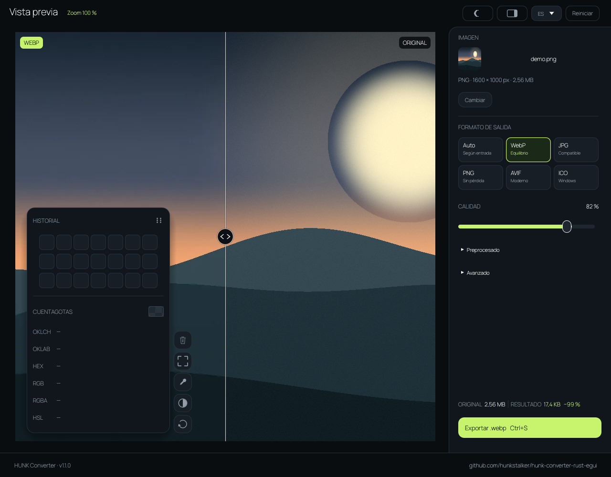
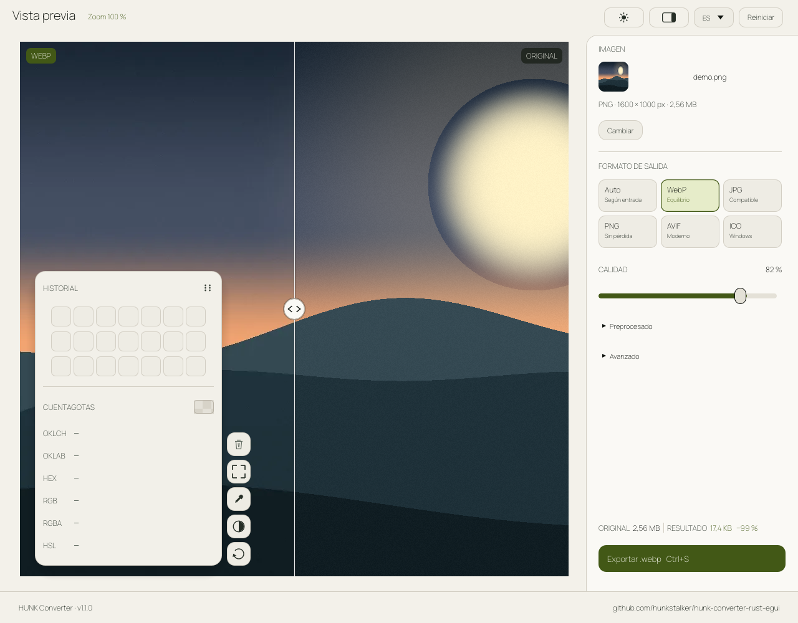
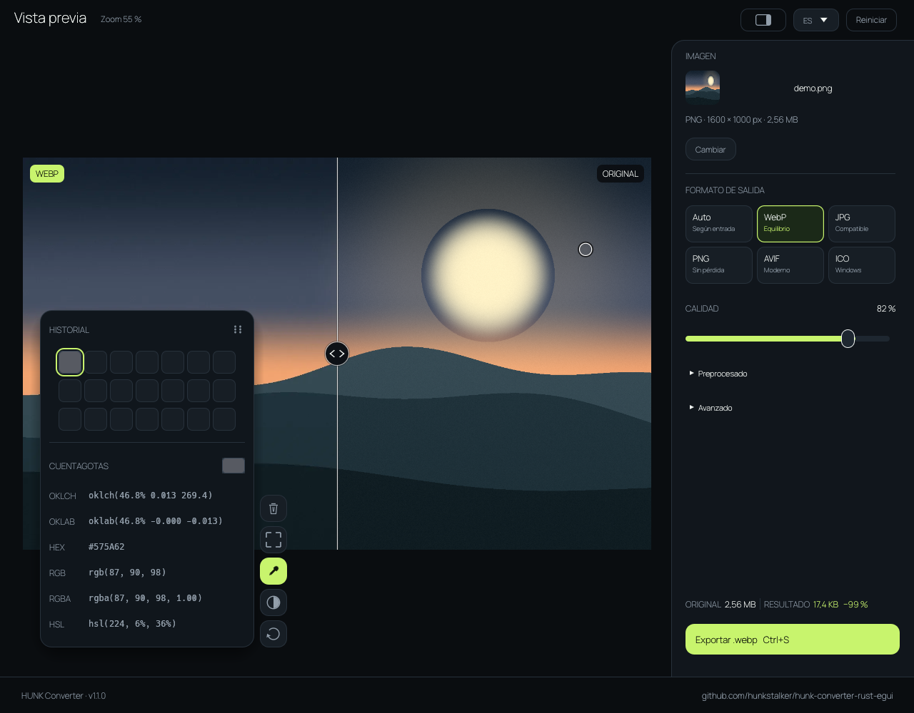
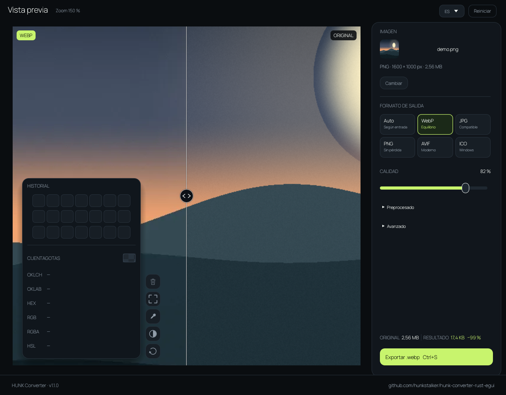
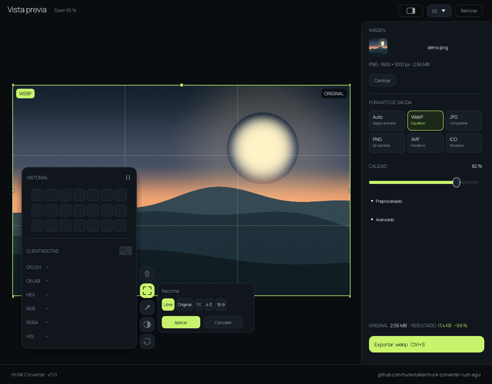
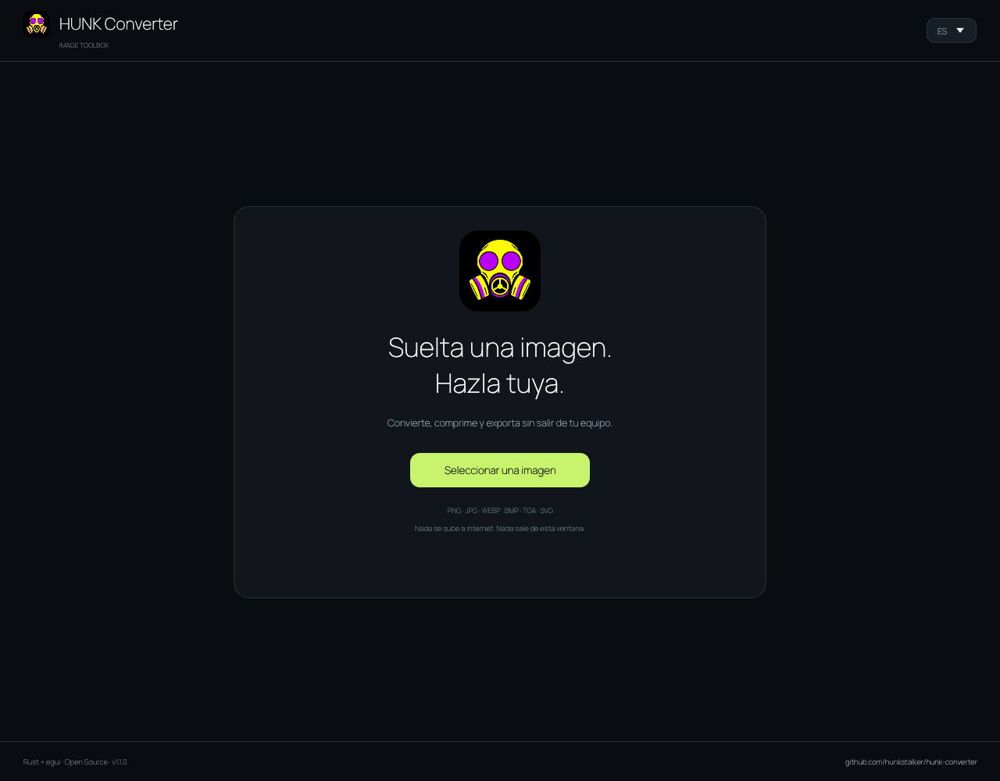
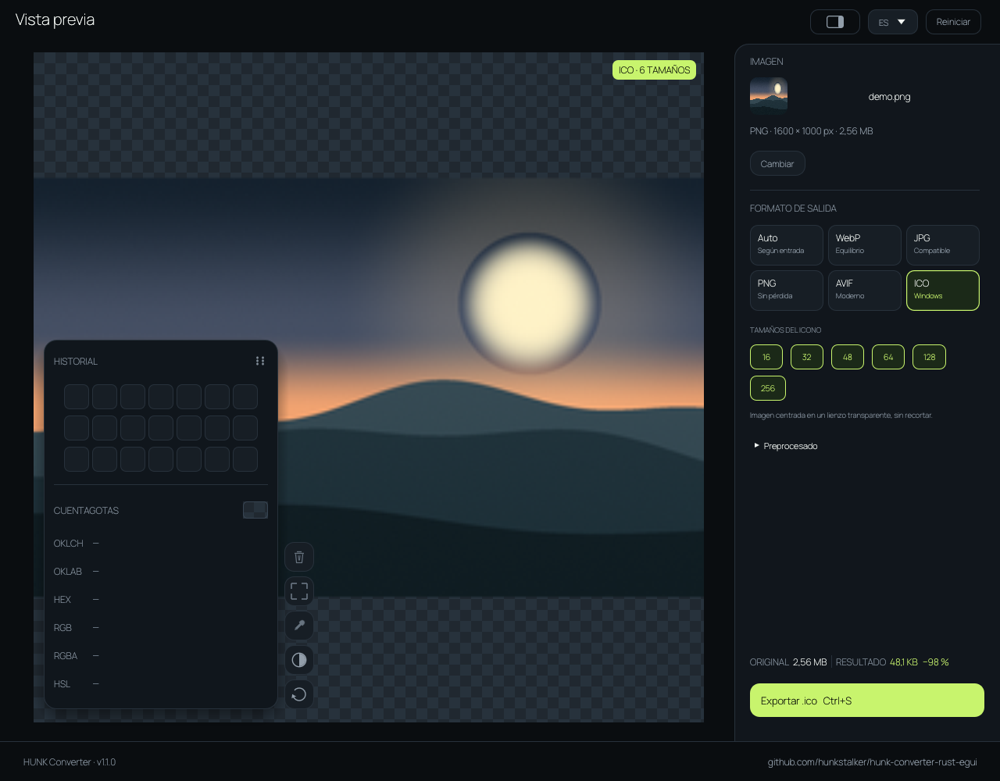

# HUNK Converter

**Convierte, comprime, compara, recorta, muestrea colores y exporta imágenes sin salir de tu equipo.**

HUNK Converter es una aplicación de escritorio local-first escrita en **Rust + egui**. Arrastra una imagen, elige el formato de salida, ajusta la calidad y comprueba el resultado real con un comparador deslizante antes de guardarlo. También genera iconos `.ico` multirresolución.

La interfaz solo repinta cuando hay actividad. No mantiene un bucle de render continuo mientras miras una imagen estática.

Todo el procesamiento ocurre en tu ordenador: no hay cuentas, subidas ni conexión a internet.

| Tema oscuro | Tema claro |
| --- | --- |
|  |  |

## Características

- **Arrastrar y soltar** en cualquier parte de la ventana, o selector nativo con `Ctrl+O`.
- **Pegar desde el portapapeles** con `Ctrl+V`, haya o no una imagen cargada.
- **Entrada:** PNG, JPG/JPEG, WebP, AVIF, BMP, TGA, TIFF y SVG.
- **Orientación EXIF/TIFF:** las fotos de móvil y los TIFF se muestran, comparan, muestrean y exportan ya orientados.
- **Salida:** WebP, AVIF, JPG, PNG e ICO, con cuadrícula de tarjetas y modo **Automático** que conserva el formato de entrada cuando existe salida equivalente.
- **Calidad ajustable** de 1 a 100 para WebP, JPG y AVIF (82 % por defecto).
- **AVIF de referencia:** libavif/AOM con YUV420 y alfa; paridad práctica con Squoosh y más velocidad.
- **Preprocesado:** resize enlazado con proporción, marco del tamaño original en el canvas, rotación con el botón rápido de 90° y paleta de 2–256 colores. Los campos numéricos aceptan arrastre vertical y expresiones como `1600/4`.
- **Recorte no destructivo:** máscara con tiradores y presets Libre, Original, 1:1, 4:3 y 16:9. El exterior se atenúa, el comparador se limita al recorte y la exportación usa solo esa zona; el recorte se puede quitar después.
- **Comparador visual** antes/después con divisor arrastrable y soporte de teclado.
- **Zoom y paneo:** rueda del ratón en cualquier punto del visor y clic derecho para desplazarte.
- **Vista previa fiel al archivo final**: se decodifica el resultado codificado real.
- **Cuentagotas:** pulsa el icono y haz clic o arrastra sobre la imagen para capturar un color. La tarjeta muestra los códigos del color capturado.
- **Códigos simultáneos:** OKLCH, OKLAB, HEX, RGB, RGBA y HSL. Al hacer clic en un código se copia su valor; con Ctrl, HEX copia `HEX#...` para conservar la etiqueta.
- **Historial de colores:** 21 colores en tres filas de siete, con bloqueo y limpieza.
- **Idiomas:** español, catalán e inglés, con detección del sistema y preferencia guardada.
- **Perfiles de color:** tema oscuro y tema claro con la misma jerarquía visual. El botón de sol/luna de los controles superiores cambia el perfil y lo guarda en `config.ini`. La barra nativa de la ventana sigue el tema del sistema operativo; el perfil solo afecta al contenido.
- **Ventana maximizada:** se abre maximizada; los controles nativos permiten maximizar o restaurar y el estado se guarda.
- **Exportación ICO** con selección de 16, 32, 48, 64, 128 y 256 px en un solo archivo.
- **Icono nativo:** ventana, `.exe` de Windows, `.app` de macOS y lanzador `.desktop` de Linux.
- **PNG sin pérdida**, con transparencia conservada en WebP/AVIF/PNG/ICO.
- **JPG sobre fondo blanco** cuando la imagen tiene transparencia.
- **Guardado con diálogo nativo:** eliges carpeta y nombre de archivo.
- **Reinicio completo** con `Ctrl+R`.
- **Portable:** builds de Linux, Windows 10/11 y macOS universal, sin instalador.
- **Local y privado:** cero llamadas de red.
- **Render bajo demanda:** sin CPU de UI en reposo.
- **Enlace al repositorio:** el pie abre `github.com/hunkstalker/hunk-converter-rust-egui` en el navegador.

## Interfaz

- Vista previa a pantalla completa con el **panel de ajustes a la derecha**.
- Formato de salida en una cuadrícula de tarjetas: WebP, JPG, PNG, AVIF, Auto e ICO.
- Historial y cuentagotas en una tarjeta flotante que se puede mover con un handle.
- Las herramientas rápidas y el desplegable de recorte se colocan a la derecha o a la izquierda de la tarjeta; al cruzar el centro horizontal de la ventana pasan al lado izquierdo.
- Botones rápidos **Recortar**, **Invertir colores** y **Girar 90°** junto a la tarjeta de color.
- El panel derecho se puede mover al lado izquierdo con el botón de los controles superiores; la elección se guarda en `config.ini`.
- Los controles superiores comparten altura y separación: `[tema] [panel] [ES] [Reiniciar]`. El icono muestra el modo activo —luna en oscuro, sol en claro— y el tooltip indica la acción. La barra de la ventana no cambia con el perfil: la dibuja el sistema operativo.

## Cuentagotas

1. Carga una imagen.
2. Pulsa el **icono de cuentagotas** en la tarjeta flotante inferior izquierda.
3. Haz clic sobre la imagen o arrastra desde el icono hasta el píxel que quieras.
4. Copia un código haciendo clic sobre él. Con `Ctrl` pulsado, HEX copia `HEX#...`.

El icono vuelve a pulsarse para desactivar el modo. También puedes cancelarlo con `Esc` o con clic derecho sobre la imagen. La marca de muestreo solo se muestra mientras el cuentagotas está activo.

La muestra se toma del píxel original, no del resultado recompimido, y conserva el canal alfa. En la vista ICO el cuentagotas se desactiva porque esa vista representa el icono generado, no la imagen de origen.



## Historial de colores

- Se guardan automáticamente los últimos **21 colores** muestreados.
- **Clic izquierdo** en una muestra: usa ese color y actualiza los códigos.
- **Clic derecho** en una muestra: la fija o la libera. Las muestras fijadas llevan un candado y no se reemplazan.
- Cuando el historial está lleno, se sustituye el color no fijado más antiguo.
- Si todos los colores están fijados, el color nuevo se muestra pero no entra al historial; aparece un aviso.
- El botón de papelera limpia los colores no fijados.
- La tarjeta se mueve con el handle de la cabecera; un doble clic en el handle la devuelve a su posición inicial. Su posición se guarda en `config.ini`.
- El historial y el estado de cada candado se conservan en `config.ini`, junto al ejecutable. Al reiniciar, los colores fijados siguen fijados.

## Idiomas y configuración

- Selector **ES / CA / EN** arriba a la derecha, sobre el lienzo.
- En el primer arranque se detecta el idioma del sistema.
- El idioma, el perfil de color (`theme=dark|light`), el historial, los bloqueos, el estado maximizado, el lado del panel, la posición del panel de color, el formato de salida y la posición/tamaño de la ventana se guardan en `config.ini`, junto al ejecutable. La ventana usa los controles nativos del sistema.
- Si no se puede escribir el archivo, la aplicación sigue funcionando sin persistencia.

## Zoom y navegación

- **La imagen se abre al 100 %.**
- **Rueda o pinza** sobre la imagen: acerca y aleja manteniendo el punto bajo el cursor.
- **Atajos:** `+`/`-` ajustan el zoom por pasos; `1` activa el tamaño real 1:1 y `0`/`F` ajusta el contenido visible. Sin recorte encuadra la imagen completa; con un recorte aplicado encuadra el propio recorte.
- **Clic derecho y arrastra**: desplaza la imagen cuando está ampliada.
- El porcentaje de zoom refleja la escala real de la imagen y se resalta en lima solo al 100 %. La vista previa no tiene botones de zoom: se controla con teclado, rueda o pinza en cualquier punto del visor.
- Con un recorte aplicado, el zoom, el paneo y el ajuste usan el recorte como referencia; `1` lo centra a escala real. Al entrar o salir de la edición se conserva la escala si estabas ampliado.
- El divisor y el cuentagotas siguen funcionando con cualquier zoom.



## Recorte

1. Pulsa el icono de **Recortar** en la columna flotante, entre la papelera y el
   cuentagotas.
2. Ajusta el marco con los ocho tiradores o elige un preset: **Libre**,
   **Original**, **1:1**, **4:3** o **16:9**. Al arrastrar un tirador el preset
   pasa a **Libre**; arrastrar dentro del marco lo desplaza sin cambiar su
   tamaño.
3. Pulsa **Aplicar** o `Enter`. Con **Cancelar** o `Esc` se descarta el borrador.

Mientras editas, el visor muestra la imagen de origen con la máscara y el
exterior atenuado. Al aplicar, dentro del recorte se compara el resultado real
con el original y fuera se mantiene la imagen completa atenuada; el divisor solo
recorre la zona recortada. La tarjeta de la imagen muestra las dimensiones de
salida y el tamaño del resultado se recalcula al aplicar. Si estabas en modo
ajuste, al aplicar el visor pasa a encuadrar el recorte; `0`/`F` lo reajusta y
`1` lo muestra a escala real centrado.

El recorte es una máscara normalizada: no modifica los píxeles de origen y se
aplica antes de codificar, así que la exportación guarda exactamente la zona
recortada. Para quitarlo, vuelve a abrir **Recortar** y usa **Quitar recorte**.
No se guarda en `config.ini`; se mantiene al cambiar de formato dentro de la
sesión. En la vista ICO el botón está desactivado, pero el recorte aplicado se
conserva y se puede quitar al volver a otro formato.



## Capturas

| Inicio | Vista ICO |
| --- | --- |
|  |  |

Las capturas usan imágenes de muestra generadas por el propio proyecto.

## Desarrollo

Guía completa: [docs/desarrollo.md](docs/desarrollo.md).

- **Local:** `./scripts/setup_dev.sh --install` en Linux/macOS o
  `.\scripts\setup_dev.ps1 -Install` en Windows.
- **Contenedor:** `docker compose run --rm dev cargo test` o **Reopen in
  Container** en VS Code.
- **Verificación:** `cargo test`, `cargo clippy --all-targets -- -D warnings` y
  `cargo fmt --all -- --check`.
- **GUI:** `cargo run --release`. Dentro del contenedor requiere X11; el
  diálogo nativo de guardado puede no estar disponible sin portal/DBus.

La guía detalla dependencias por sistema, Xvfb, UID/GID y solución de problemas.

## Uso

1. Arrastra una imagen a la ventana, pulsa **Seleccionar una imagen** o usa `Ctrl+V`.
2. Elige **WebP**, **AVIF**, **JPG**, **PNG** o **ICO**.
3. Ajusta la calidad o los tamaños del icono.
4. Recorta si lo necesitas con **Recortar**; el marco se aplica al resultado y a la exportación.
5. Arrastra el divisor para comparar. Usa la rueda para acercar y el clic derecho para moverte por la imagen.
6. Activa el cuentagotas si necesitas extraer colores.
7. Pulsa **Exportar** o `Ctrl+S`.

Al exportar se abre el explorador nativo para elegir la carpeta y el nombre. Si no escribes extensión, se añade la del formato actual.

### Atajos

| Atajo | Acción |
| --- | --- |
| `Ctrl+O` | Abrir imagen |
| `Ctrl+V` | Pegar una imagen del portapapeles |
| `Ctrl+S` | Exportar |
| `Ctrl+R` | Reiniciar la aplicación |
| `0` / `F` | Ajustar la imagen o el recorte a la ventana |
| `1` | Tamaño real 1:1 y centrar el recorte aplicado |
| `+` / `-` | Aumentar o reducir zoom |
| `←` / `→` | Mover el divisor del comparador |
| `Inicio` / `Fin` | Llevar el divisor a un extremo |
| `Tab` / `Shift+Tab` | Mover el foco entre controles |
| `Enter` / `Espacio` | Activar el control enfocado |
| `↑` / `↓` | Desplazar la imagen verticalmente cuando está ampliada |
| `Shift+←` / `Shift+→` | Desplazar la imagen horizontalmente cuando está ampliada |
| `L` | Bloquear o desbloquear el color enfocado del historial |
| `Enter` / `Esc` | Aplicar o cancelar el recorte en edición |
| `Esc` | Cancelar el cuentagotas |

`Ctrl+E` sigue funcionando como alias de exportación.

Con el cuentagotas activo y el lienzo enfocado, las flechas mueven el punto de
muestra 1 px y con `Shift` 10 px; `Enter` confirma el color.

## Accesibilidad

- **AccessKit** está activo. Los controles estándar y los personalizados
  exponen rol, nombre, estado y valor; los avisos se anuncian como alertas.
- El **comparador** se expone como un slider de 0–100 % y se controla con
  flechas, `Inicio` y `Fin`. El cuentagotas y el historial se pueden usar con
  teclado.
- Todos los controles tienen **anillo de foco visible**. Los formatos funcionan
  como grupo de radios y el historial usa un único tab stop con navegación por
  flechas.
- El texto informativo cumple contraste WCAG AA (4,5:1) y el foco 3:1. Hay una
  prueba automática de contraste y pruebas de la navegación por teclado.
- La validación manual con teclado está cubierta; AccessKit expone la interfaz
  a los lectores de pantalla compatibles.

## Formatos

| Formato | Entrada | Salida | Transparencia | Calidad |
| --- | :---: | :---: | :---: | :---: |
| WebP | ✓ | ✓ | Sí | 1–100 |
| AVIF | ✓ | ✓ | Sí | 1–100 |
| JPG / JPEG | ✓ | ✓ | No (fondo blanco) | 1–100 |
| PNG | ✓ | ✓ | Sí | Sin pérdida |
| ICO | — | ✓ | Sí | Tamaños fijos |
| BMP | ✓ | — | Según archivo | — |
| TGA | ✓ | — | Según archivo | — |
| TIFF | ✓ | — | Sí, 8 bits | Sin pérdida |
| SVG | ✓ | — | Rasterizado | — |

Los SVG se rasterizan con `resvg` al tamaño declarado. Los TIFF se cargan como primera página RGBA8; se admiten RGB, RGBA, gris y gris con alfa de 8 bits. AVIF se abre con `avif-decode` y se convierte a RGBA8. La salida AVIF usa libavif/AOM con YUV420, BT.601 y cuantizador directo; AOM se enlaza estáticamente. PNG muestra el deslizador de calidad deshabilitado porque no modifica la calidad de la imagen. La ampliación de entrada/salida y las opciones avanzadas están especificadas en [docs/formatos.md](docs/formatos.md); el alcance vigente de 1.1 está en [docs/objetivo-1.1-web.md](docs/objetivo-1.1-web.md). El límite de entrada es de 200 MB y 40 megapíxeles (máximo 16 384 px por lado).

## Builds portables

Cada build es una carpeta autocontenida. Al exportar se elige la ruta con el diálogo nativo; si existe, se propone la carpeta `export/` junto al ejecutable.

```text
hunk-converter-1.1.0-windows-x86_64/
├── hunk-converter.exe
├── config.ini          (se crea al primer arranque)
├── export/
├── LEEME.txt
├── LICENSE.txt
└── LICENCIAS/
    └── Manrope-OFL.txt
```

```bash
./scripts/build_dist.sh linux
./scripts/build_dist.sh windows
./scripts/build_dist.sh macos
./scripts/build_dist.sh all
```

Los resultados se generan en `dist/`:

- Linux: carpeta y `.tar.gz`.
- Windows: carpeta y `.zip` (el CI lo genera con PowerShell).
- macOS: carpeta y `.tar.gz` con binario universal `arm64 + x86_64`.

`all` compila Linux y Windows; macOS necesita un runner macOS porque usa `lipo`.

La entrega Linux incluye `hunk-converter.desktop` y `hunk-converter.png`. La entrega macOS incluye `HUNK Converter.app` con `icon.icns`.

La build Windows está validada en Windows 10/11, con el icono embebido mediante `winresource` visible en Explorer y barra de tareas. La build Linux se validó bajo X11, incluyendo la exportación mediante diálogo nativo. La build macOS se empaqueta como `HUNK Converter.app` con `icon.icns`.

## Pruebas

```bash
cargo test
cargo clippy --all-targets -- -D warnings
cargo fmt --all -- --check
```

La suite cubre 72 pruebas: codificación WebP/JPG/PNG/AVIF con AOM/JPEG XL, JPG progresivo y submuestreo automático, PNG sin pérdida con OxiPNG, WebP lossless/method/alfa, AVIF YUV420/cuantificador/alfa, preprocesado y opciones avanzadas sin persistencia, orientación EXIF y TIFF, compresiones TIFF, entrada TIFF de una página, matriz de entradas PNG/JPG/WebP/AVIF/BMP/TGA/TIFF/SVG, límites y errores, recorte antes de codificar, presets de proporción y conversión a píxeles, colocación del panel de color y del flyout, historial y bloqueos, configuración, perfiles de color y su ida y vuelta en `config.ini`, calidad, transparencia, aplanado JPG, estructura ICO, códigos de color, rasterización SVG, nombres de exportación, rutas portables, geometría de ventana, selección de formato, contraste de todos los perfiles y navegación por teclado. También se ejecuta en GitHub Actions.

Al empujar un tag de versión, el workflow de release compila Linux Debian x86_64, Windows 10/11 x86_64 y macOS universal, y publica los artefactos y sus checksums en GitHub. Ver [`docs/ci.md`](docs/ci.md).

## Rendimiento

La versión Rust/egui se comparó con el prototipo Godot antes de migrar. En el mismo entorno Linux y con la misma imagen, el binario, la memoria, el arranque y los tiempos de codificación son claramente menores. El informe completo, la metodología y las limitaciones están en:

[`docs/benchmark-2026-10-28.md`](docs/benchmark-2026-10-28.md)

## Estructura

```text
.
├── .devcontainer/          Integración con VS Code/Codespaces
├── assets/                 Iconos, tipografía y licencias
├── docker/dev.Dockerfile   Imagen de desarrollo reproducible
├── docs/                   Capturas, benchmark, arquitectura, CI, formatos y guías
├── notes/                  Evidencia fechada de las sesiones
├── build.rs                Icono embebido del .exe de Windows
├── compose.yaml            Servicio dev y volúmenes de Cargo
├── scripts/build_dist.sh   Empaquetado portable
├── scripts/setup_dev.*     Dependencias locales en Linux/macOS/Windows
├── src/
│   ├── app/                Shell, estado, acciones y componentes egui
│   │   ├── actions.rs      Efectos explícitos devueltos por la UI
│   │   ├── crop.rs         Estado y acciones del recorte no destructivo
│   │   ├── encoding.rs     Worker de codificación y revisiones
│   │   ├── export.rs       Exportación mediante diálogo nativo
│   │   ├── session.rs      Carga, pegado, reinicio y formato
│   │   ├── state.rs        SourceImage, RenderedResult, CropRect y Toast
│   │   └── ui/             Panel lateral, color flotante, preview y widgets
│   ├── codec/              WebP, JPG, PNG, AVIF, JPEG XL, ICO, SVG y TIFF
│   ├── domain/             Formatos, recorte, color, historial y errores tipados
│   ├── settings/           config.ini, idioma, tema, historial y maximizado
│   ├── bin/                Benchmarks, muestra y generador de icono
│   ├── demo.rs             Imagen sintética para capturas
│   ├── i18n.rs             Textos en español, catalán e inglés
│   └── theme.rs            Perfiles de color, paleta dinámica y estilos
├── tests/                  Matriz de integración de formatos y límites
├── proyecto.md             Documento vivo
├── todo.md                 Tareas pendientes
├── t-completadas.md        Tareas cerradas
└── retomar.md              Punto de entrada para nuevas sesiones
```

## Documentación

- [proyecto.md](proyecto.md) — producto, funcionalidad y arquitectura.
- [todo.md](todo.md) — tareas pendientes.
- [t-completadas.md](t-completadas.md) — tareas cerradas.
- [retomar.md](retomar.md) — estado y contexto para continuar.
- [docs/desarrollo.md](docs/desarrollo.md) — entorno local, dependencias por sistema y contenedor.
- [docs/objetivo-1.1-web.md](docs/objetivo-1.1-web.md) — objetivo y alcance web de 1.1.
- [docs/formatos.md](docs/formatos.md) — matriz de formatos, entrada/salida y opciones avanzadas.
- [docs/plan-formatos-y-opciones.md](docs/plan-formatos-y-opciones.md) — plan histórico de ampliación de formatos.
- [notes/](notes/) — evidencia fechada.
- [docs/benchmark-2026-10-28.md](docs/benchmark-2026-10-28.md) — benchmark Godot vs Rust.
- [docs/benchmark-squoosh-2026-10-31.md](docs/benchmark-squoosh-2026-10-31.md) — benchmark HUNK vs Squoosh.
- [docs/pruebas.md](docs/pruebas.md) — capas de prueba y matriz de cobertura.
- [docs/arquitectura.md](docs/arquitectura.md) — decisiones de arquitectura y reglas de código.
- [docs/ci.md](docs/ci.md) — workflows, artefactos y publicación de releases.

El prototipo Godot original se conserva como archivo histórico en `../Prototipo`.

## Licencia

Código bajo [MIT](LICENSE). La tipografía Manrope se distribuye bajo la SIL Open Font License 1.1; su licencia está incluida en [assets/fonts/OFL.txt](assets/fonts/OFL.txt).
